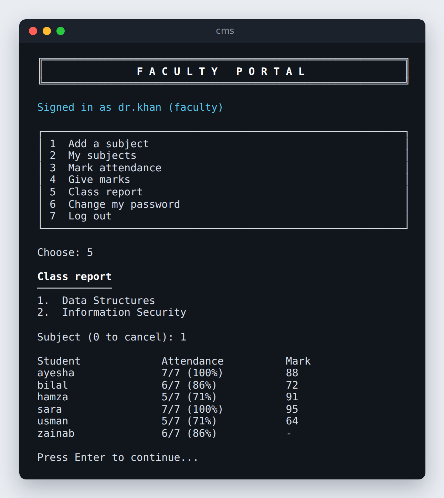
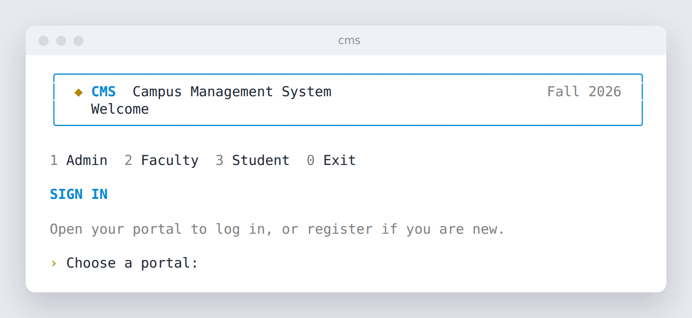
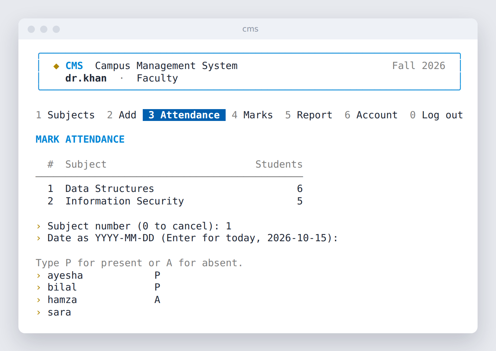
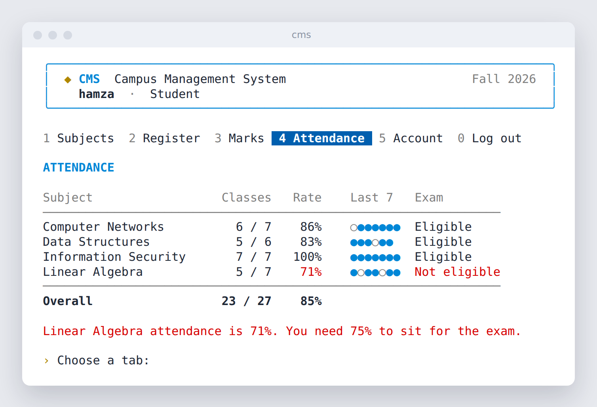
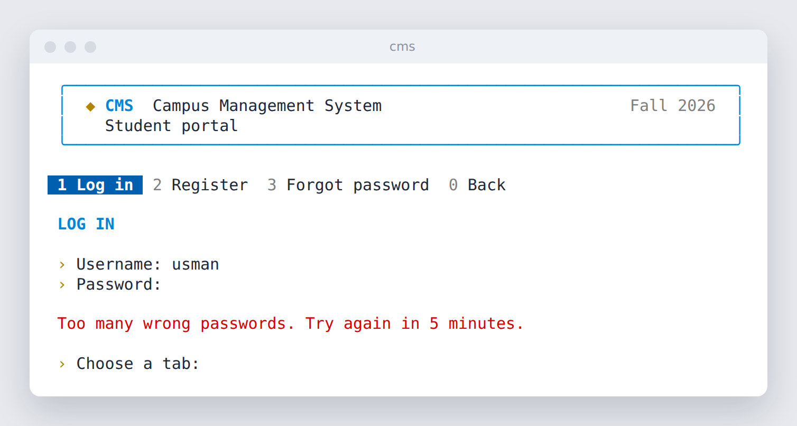

# CMS Portal

A campus management system that runs in the terminal, written in C++17. It has three portals: admins manage accounts, faculty run their subjects (attendance and marks), and students register for subjects and follow their progress. Passwords are stored as salted PBKDF2 hashes, every action is checked against the user's role, and the project builds and is tested on Windows, Linux and macOS.



## Features

**Admin portal**
- Created on first run. There is no default admin password.
- Look up a faculty member (and what they teach) or a student (and what they take)
- List every account
- Reset a forgotten password, which also unlocks a locked account

**Faculty portal**
- Add subjects with credit hours
- Mark attendance for a class on any past date, one P or A per registered student
- Give marks from 0 to 100
- Class report: each student's attendance percentage and mark

**Student portal**
- Register for subjects and see total credit hours
- View marks and attendance per subject, such as "5 of 6 classes (83%)"

**Everyone**
- Change your own password
- Subject and user names can contain spaces and other characters without breaking anything
- A wrong key at a menu prompt just asks again

## Security

- **Password storage:** PBKDF2-HMAC-SHA256 with 600,000 iterations (OWASP guidance) and a random 16-byte salt per account, from the operating system's secure random source. Two users with the same password get different hashes.
- **No password recovery by design:** "Forgot password" explains that passwords can't be looked up. The admin resets them instead.
- **Roles are enforced in the core logic, not only hidden in the menus.** A faculty member can only mark attendance and give marks for subjects they teach, and only for students registered in them. Only an admin can reset passwords, and admin accounts can't be self-registered.
- **Login lockout:** 5 wrong passwords lock the account for 5 minutes. The lock is saved to disk, so restarting the program doesn't reset it.
- **No account guessing:** an unknown username gets the same message and takes the same time as a wrong password, so nobody can use the login screen to find out which usernames exist. Hashes are compared in constant time.
- **Hidden password typing** on Windows, Linux and macOS.
- **Safe file writes:** data is written to a temporary file and then renamed, so a crash never leaves a half-written file. Damaged or edited lines are skipped instead of trusted.

### Security fixes from self-review

This started as my university Object-Oriented Programming course project. Reviewing the original code later, I found and fixed these problems:

- **Plain-text passwords** in `studentacc.txt` and `facultyacc.txt`. They are now salted hashes.
- **"Forgot password" printed the password** to anyone who typed a username. It now points to an admin reset.
- **Account takeover:** registering an existing username created a second account with a new password, which then let you log in as the original user. Usernames are now unique across all roles.
- **Hardcoded admin login** (`admin` / `1234`) in the source code. The admin account is now created on first run.
- **No authorization:** any faculty member could change any student's marks and attendance in any subject, including subjects the student never took. Both are now blocked.
- **Marking attendance deleted all earlier attendance** for every student, because the list was rebuilt from an empty copy and saved over the file.
- **Unchecked marks:** 999 or -5 were accepted. Marks are now 0 to 100.
- **One student's password could hide other students:** a password with letters broke the file reader for every account after it.
- **Typing a letter at a number prompt** made the program loop forever.
- Subject names with spaces corrupted the data files, an uninitialized pointer was used for attendance, and some checks answered "has any student registered" instead of "has this student registered".

Each of these has a regression test in [`tests/test_portal.cpp`](tests/test_portal.cpp).

## Build and run

You need CMake 3.16 or newer and a C++17 compiler: Visual Studio 2019 or newer, GCC 9 or newer, or Clang 10 or newer. There are no other dependencies.

```bash
cmake -S . -B build
cmake --build build --config Release
```

Then run it:

```bash
./build/cms                 # Linux and macOS
build\Release\cms.exe       # Windows (Visual Studio)
```

On the first run it asks you to create the admin account. Accounts and records are saved in a `data` folder in the current directory. Use `--data <folder>` to keep them somewhere else.

**Visual Studio:** choose File, Open, Folder, pick this folder, and Visual Studio sets up CMake on its own. Use a Release configuration, because password hashing is much slower in Debug builds.

### Tests

```bash
ctest --test-dir build -C Release --output-on-failure
```

There are 35 tests:

- The SHA-256, HMAC and PBKDF2 code is checked against the official test vectors (FIPS 180-4, RFC 4231, RFC 7914).
- The file format is checked for round trips.
- Every rule and old bug listed above has its own test.

GitHub Actions builds the project and runs the tests on Windows, Linux and macOS on every push.

## Screenshots

**Home screen**



**Faculty marking attendance**



**A student's attendance**



**Locked out after 5 wrong passwords**



## How data is stored

Each table is a tab-separated text file in the `data` folder: `users.tsv`, `subjects.tsv`, `enrollments.tsv`, `attendance.tsv` and `marks.tsv`. Tabs, newlines and backslashes inside a value are escaped. A user line looks like this:

```
student	sara	pbkdf2-sha256$600000$<salt>$<hash>	0	0
```

These fields are: role, username, password hash, wrong attempts so far and the lock end time.

## OOP design

The project keeps the object-oriented design from the course:

- **Inheritance and polymorphism:** `Admin`, `Faculty` and `Student` inherit from an abstract `User` class. `AdminDashboard`, `FacultyDashboard` and `StudentDashboard` inherit from `Dashboard`, which runs the shared menu loop and calls each one's virtual `title()`, `options()` and `handle()`.
- **Encapsulation:** all records live inside the `Portal` class, and the only way to change them is through its methods, which enforce the rules.
- **Separation of concerns:** crypto, storage, rules and screens are separate classes, so the rules can be tested without the menus.

## Project structure

- `include/cms/` and `src/`: the code
  - `crypto`: SHA-256, HMAC-SHA256, PBKDF2 and secure random bytes
  - `storage`: reads and writes the data files
  - `portal`: users, roles, subjects, attendance and marks, with every rule enforced here
  - `console`: boxes, menus, safe number input and hidden password input
  - `app`: the screens. `AdminDashboard`, `FacultyDashboard` and `StudentDashboard` share one `Dashboard` base class.
- `tests/`: the tests
- `.github/workflows/`: the build on all three systems

## Limitations

- **Records aren't encrypted.** Passwords are hashed, but marks and attendance are plain text, so anyone who can open the `data` folder can read or edit them. A real deployment would use a database server with access control.
- **One program at a time.** The program is meant for one person at a time on one computer. Two copies writing to the same `data` folder at once can overwrite each other's changes.
- **Home-made crypto code.** SHA-256 and PBKDF2 are written in the project so it has no dependencies, and they are tested against the official vectors. A production system should use a vetted library such as OpenSSL or libsodium, ideally with a memory-hard algorithm like Argon2.

## License

Released under the [MIT License](LICENSE).
